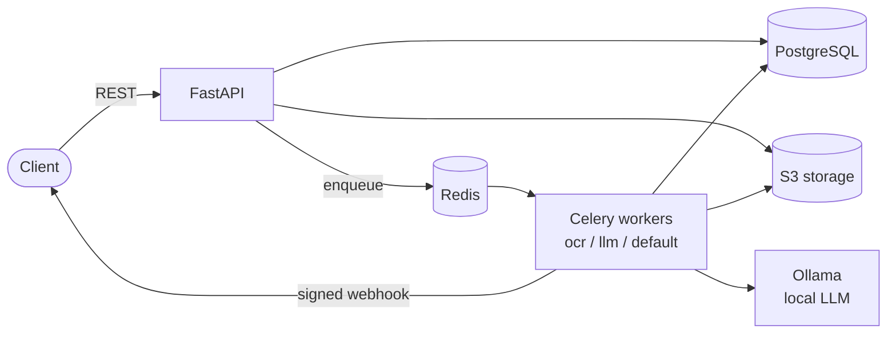

# Sift

**Self-hosted invoice extraction.** Upload a PDF or image; get validated, structured JSON back, with low-confidence results routed to human review. Runs on free, open-source components by default (local OCR + local LLM), and moves to paid providers by changing configuration, not code.

[](https://github.com/connectaliraza/sift/actions/workflows/ci.yml)


> **Status: Week 1 of 4.** Upload, storage, job tracking and the API → queue → worker path are done and tested. OCR, extraction and validation land in week 2. See the [roadmap](#roadmap).

---

## Why

Small businesses still re-type invoices by hand. Hosted AI extraction services cost money per page and require sending financial documents to a third party. Sift is the self-hosted alternative, built to be **correct under failure**: no lost jobs, no duplicates, and no silent wrong values.

## Architecture



Highlights (details in the [TRD](docs/TRD.md)):

- **Idempotent uploads:** `Idempotency-Key` header, enforced by a unique constraint, safe under concurrent retries.
- **Crash-safe tasks:** `acks_late` + compare-and-set state transitions; Postgres is the source of truth, not the broker.
- **Ports and adapters:** storage, OCR, LLM and queue sit behind interfaces; `import-linter` enforces the boundaries in CI.
- **End-to-end tracing:** one `correlation_id` follows a document from the HTTP request through every Celery task, in structured JSON logs.
- **RFC 9457 errors:** every error has a stable `code` ([reference](docs/errors.md)).

## Quick start

**Prerequisites:** Docker (or OrbStack), [uv](https://docs.astral.sh/uv/), [Ollama](https://ollama.com) running natively.

```bash
git clone https://github.com/connectaliraza/sift.git && cd sift
ollama pull qwen2.5:3b          # used from week 2
make setup                      # deps, git hooks, .env
docker compose up --build -d
```

Upload an invoice:

```bash
curl -s -X POST localhost:8000/v1/documents \
  -H "X-API-Key: change-me-dev-api-key" \
  -H "Idempotency-Key: $(uuidgen)" \
  -F "file=@invoice.pdf"
# {"id":"01a2...","status":"received","created_at":"..."}

curl -s localhost:8000/v1/documents/<id> -H "X-API-Key: change-me-dev-api-key"
```

Interactive API docs: <http://localhost:8000/docs> · Storage console: <http://localhost:9001>

### Profiles: 8 GB laptop vs full

| | `lean` (default) | `full` |
|---|---|---|
| Workers | 1 worker, all queues | separate `ocr`, `llm`, `default` pools |
| Flower | — | <http://localhost:5555> |
| Target | 8 GB RAM | 16 GB+ / server |

`COMPOSE_PROFILES=full docker compose up -d`. Routing is identical in both; only the process layout changes.

## Development

```bash
make infra        # Postgres, Redis, storage in Docker
make migrate      # apply migrations + create bucket
make dev-api      # API with hot reload (native)
make dev-worker   # Celery worker (native)
make check        # lint, types, architecture rules, tests
```

```
src/sift/
├── api/        HTTP: routers, DTOs, error handling, middleware
├── workers/    Celery app + thin task wrappers
├── services/   use cases (framework-free)
├── domain/     entities, rules, errors (pure Python)
├── ports/      interfaces services depend on
├── adapters/   S3, pypdf, Celery (later: OCR, LLM, webhooks)
└── db/         SQLAlchemy models + repositories
```

**Tests:** unit tests use in-memory fakes and run in about 2 s. Integration tests run the real Alembic migrations against Postgres and Redis, with S3 provided by moto. They cover idempotency races (8 concurrent uploads, same key → exactly one document) and the exact Celery message format on the wire.

## Roadmap

- [x] **Week 1:** Foundation: upload, storage, idempotency, health/readiness, Celery wiring, CI
- [ ] **Week 2:** Pipeline: OCR → LLM extraction → validation, confidence scoring
- [ ] **Week 3:** Reliability: review & retry endpoints, transactional-outbox webhooks, sweeper
- [ ] **Week 4:** Proof: eval set + accuracy in CI, demo GIF

## Docs

[PRD](docs/PRD.md) · [TRD](docs/TRD.md) · [ADRs](docs/adr/README.md) · [Errors](docs/errors.md)

## License

MIT
