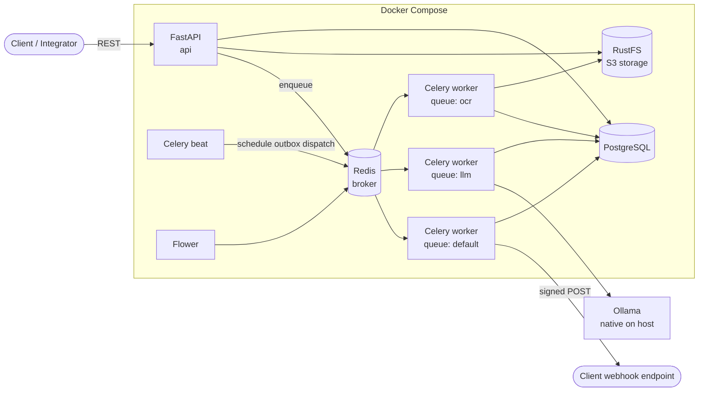
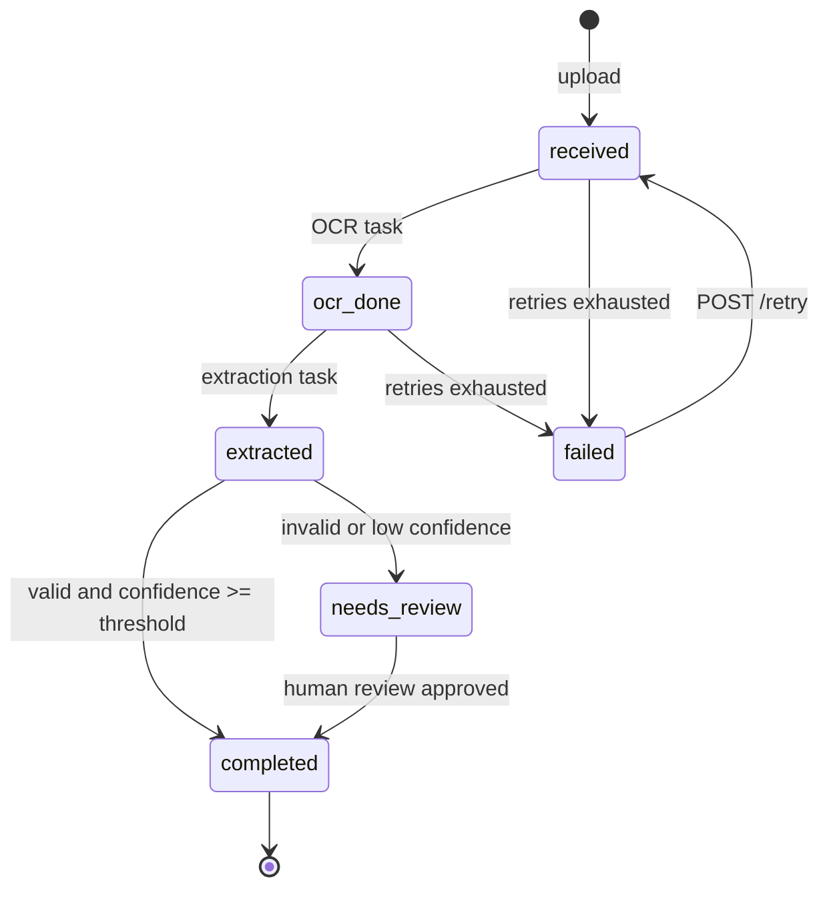
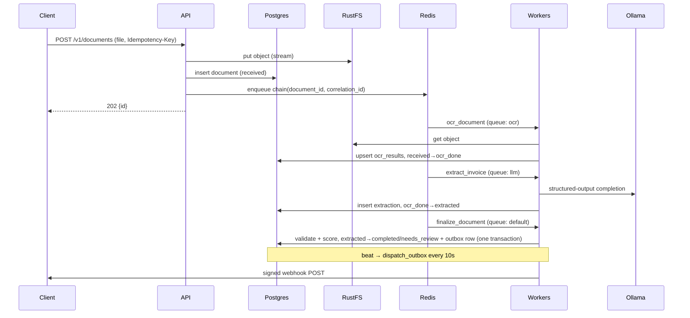

# Sift — Technical Requirements / Design Document (TRD)

| | |
|---|---|
| **Status** | Draft v0.2 |
| **Owner** | _your name_ |
| **Last updated** | 2026-11-25 |
| **Related** | [PRD](./PRD.md) · [ADRs](./adr/) |

---

## 1. Overview

Sift is an asynchronous document-processing service. A **FastAPI** application accepts uploads and serves results; **Celery** workers run OCR, LLM extraction and validation; **PostgreSQL** stores state; **Redis** is the Celery broker; **RustFS** stores files; **Ollama** serves a local LLM. Everything except Ollama runs under **Docker Compose**; Ollama runs natively on the host (see §16).

Design principles:
1. **Correct under failure** – every task is idempotent; crashes and retries never corrupt state or duplicate side effects.
2. **Ports and adapters** – OCR, LLM, storage and webhooks sit behind interfaces; free → paid is a config change.
3. **Framework-free core** – domain and service code never imports FastAPI or Celery.
4. **Observable by default** – structured logs with a correlation ID across API and workers.
5. **Boring where possible** – no technology without a reason recorded in an ADR.

---

## 2. Architecture



### 2.1 Components

| Component | Responsibility | Scales by |
|---|---|---|
| `api` | Validation, auth, upload, read/review endpoints, enqueueing. Stateless. | Replicas |
| `worker-ocr` | CPU-bound OCR. Low concurrency (= CPU cores). | Replicas / cores |
| `worker-llm` | I/O-bound LLM calls. Concurrency limited to protect Ollama. | Concurrency |
| `worker-default` | Validation, finalisation, webhook delivery. | Concurrency |
| `beat` | Periodic outbox dispatch and stuck-job sweeper. **Exactly one instance.** | — |
| `postgres` | Source of truth for jobs, results, outbox. | — |
| `redis` | Celery broker + result backend (results unused; state lives in Postgres). | — |
| `objectstore` | Original files (RustFS, S3-compatible). | — |
| `ollama` | Local LLM inference. Runs natively on the host, outside Compose (§16). | — |
| `flower` | Celery monitoring UI (dev/ops). | — |

### 2.2 Why separate queues
OCR is CPU-heavy and slow; LLM calls are long-waiting I/O. On one queue, a burst of OCR jobs would starve extraction (and vice versa). Separate queues let each worker pool have a concurrency that suits its workload.

---

## 3. Tech stack

| Concern | Choice (free, default) | Paid/managed later | Notes |
|---|---|---|---|
| Language | Python 3.12 | — | |
| Packaging | `uv` | — | Lockfile committed. |
| API | FastAPI + Pydantic v2 | — | |
| DB access | SQLAlchemy 2.0 (async in API, sync in workers) + Alembic | Managed Postgres | Shared model definitions. |
| Queue | Celery 5 + Redis | Managed Redis / RabbitMQ | |
| Storage | RustFS (`boto3`) | AWS S3 | Same S3 API, endpoint via config. MinIO CE images were withdrawn in 2025 (ADR 0002). |
| OCR | Tesseract (`pytesseract`) + `pdf2image`; Docling optional | Textract / Azure DI | Behind `OcrEngine` port. |
| LLM | Ollama (native on host), 3B instruct model by default (e.g. `qwen2.5:3b`), via LiteLLM | OpenAI / Anthropic / etc. | Behind `Extractor` port; model is a config string. |
| Config | `pydantic-settings` | Secret manager | 12-factor, env vars only. |
| Logging | `structlog` (JSON) | Datadog / Grafana Cloud | |
| Monitoring | Flower | Prometheus + Grafana | |
| Tests | pytest, testcontainers, respx | — | |
| Quality | ruff, mypy, pre-commit | — | |
| CI | GitHub Actions | — | Free for public repos. |

---

## 4. Repository layout

```
sift/
├── src/sift/
│   ├── api/                # FastAPI: routers, schemas (DTOs), deps, error handlers
│   ├── workers/            # Celery app, task definitions (thin), beat schedule
│   ├── services/           # Use cases: ingest, run_ocr, extract, validate, finalize, review
│   ├── domain/             # Entities, enums, invoice schema, validation rules, confidence scoring
│   ├── ports/              # Protocols: OcrEngine, Extractor, ObjectStorage, WebhookSender
│   ├── adapters/           # tesseract.py, litellm_extractor.py, s3_storage.py, http_webhook.py
│   ├── db/                 # SQLAlchemy models, session factories, repositories
│   ├── core/               # settings, logging, correlation-id context
│   └── main.py             # FastAPI app factory
├── migrations/             # Alembic
├── prompts/                # Versioned prompt templates: invoice_v1.md, ...
├── evals/                  # Labelled sample invoices + expected JSON + run_eval.py
├── tests/                  # unit/ (fast, no I/O) and integration/ (testcontainers)
├── docker/                 # Dockerfiles
├── docs/                   # PRD, TRD, ADRs, diagrams
├── docker-compose.yml
├── .env.example
└── pyproject.toml
```

**Dependency rule:** `api` and `workers` → `services` → `domain` + `ports`. `adapters` implement `ports`. `domain` imports nothing from the project except itself. Enforced with `import-linter` in CI.

---

## 5. Data model

### 5.1 Tables

**`documents`**

| Column | Type | Notes |
|---|---|---|
| `id` | UUID (v7) PK | Time-ordered. |
| `idempotency_key` | text, unique, nullable | From `Idempotency-Key` header. |
| `original_filename` | text | |
| `content_type` | text | Detected from file bytes, not trusted from client. |
| `size_bytes` | int | |
| `sha256` | char(64) | For dedup analytics and integrity. |
| `storage_key` | text | `documents/{id}/original.{ext}` |
| `page_count` | int, nullable | |
| `status` | enum | See §6. |
| `failure_reason` | text, nullable | Machine-readable code. |
| `attempts` | int | Pipeline runs. |
| `webhook_url` | text, nullable | |
| `current_extraction_id` | UUID FK, nullable | Latest accepted extraction. |
| `created_at`, `updated_at` | timestamptz | |

**`ocr_results`** — `document_id` (PK/FK), `engine`, `engine_version`, `pages` (JSONB: `[{page, text, mean_confidence}]`), `duration_ms`, `created_at`. Upsert by `document_id` (idempotent).

**`extractions`** (append-only history)

| Column | Type | Notes |
|---|---|---|
| `id` | UUID PK | |
| `document_id` | UUID FK | |
| `source` | enum `llm` / `human` | |
| `data` | JSONB | Invoice schema instance. |
| `field_meta` | JSONB | Per field: `confidence`, `page`, `evidence`, `grounded`. |
| `confidence` | numeric(4,3) | Document-level score. |
| `validation_errors` | JSONB | List of rule violations. |
| `model`, `prompt_version` | text | Null for human. |
| `input_tokens`, `output_tokens`, `duration_ms` | int | Cost/latency tracking. |
| `created_at` | timestamptz | |

**`outbox_events`**

| Column | Type | Notes |
|---|---|---|
| `id` | UUID PK | Also used as webhook delivery ID. |
| `document_id` | UUID FK | |
| `event_type` | text | `document.completed`, `document.needs_review`, `document.failed` |
| `payload` | JSONB | |
| `status` | enum `pending` / `delivered` / `dead` | |
| `attempts` | int | |
| `next_attempt_at` | timestamptz | Indexed with `status`. |
| `last_error` | text | |
| `created_at`, `delivered_at` | timestamptz | |

### 5.2 Invoice schema (domain, Pydantic)

```python
class LineItem(BaseModel):
    description: str
    quantity: Decimal | None
    unit_price: Decimal | None
    amount: Decimal


class Invoice(BaseModel):
    vendor_name: str
    vendor_tax_id: str | None
    invoice_number: str
    invoice_date: date
    due_date: date | None
    currency: str  # ISO 4217
    subtotal: Decimal | None
    tax_amount: Decimal | None
    total_amount: Decimal
    line_items: list[LineItem]
```

Money is always `Decimal`, never `float`. Serialized as strings in JSON.

---

## 6. Document lifecycle



State changes are **compare-and-set**:

```sql
UPDATE documents SET status = :to, updated_at = now()
WHERE id = :id AND status = :from;
```

If zero rows are updated, the task logs and exits; another run already moved it on. This is what makes duplicate task delivery harmless.

---

## 7. API contract

Base path `/v1`. Auth via `X-API-Key` (compared with `secrets.compare_digest`). Errors use **RFC 9457 Problem Details** (`application/problem+json`).

| Method & path | Purpose | Success |
|---|---|---|
| `POST /v1/documents` | Multipart upload (`file`, optional `webhook_url`). Header `Idempotency-Key` optional. | `202` `{id, status}` |
| `GET /v1/documents/{id}` | Status, current extraction, field meta, validation errors. | `200` |
| `GET /v1/documents?status=needs_review&limit=&cursor=` | List, cursor-paginated by `id` (UUIDv7). | `200` |
| `PATCH /v1/documents/{id}/review` | Body: full corrected `Invoice`. Allowed only in `needs_review`. Creates `human` extraction, moves to `completed`. | `200` |
| `POST /v1/documents/{id}/retry` | Allowed only in `failed`. | `202` |
| `GET /health` | Process alive. | `200` |
| `GET /ready` | DB, Redis, RustFS reachable. | `200` / `503` |

**Idempotency behaviour**
- Same key + same file hash → return the original `202` response.
- Same key + different file hash → `409 Conflict`.

**Upload validation:** size ≤ 10 MB (enforced while streaming), type detected from magic bytes (`application/pdf`, `image/png`, `image/jpeg`), PDF ≤ 10 pages → else `413`/`415`/`422`.

**Example `GET` response (trimmed)**

```json
{
  "id": "0193f1c2-...",
  "status": "needs_review",
  "confidence": 0.72,
  "data": { "invoice_number": "INV-1042", "total_amount": "1180.00", "...": "..." },
  "field_meta": {
    "total_amount": { "confidence": 0.95, "page": 1, "evidence": "TOTAL 1,180.00", "grounded": true },
    "due_date":     { "confidence": 0.40, "page": null, "evidence": null, "grounded": false }
  },
  "validation_errors": [
    { "rule": "line_items_sum_to_subtotal", "detail": "sum 1000.00 != subtotal 1100.00" }
  ]
}
```

---

## 8. Processing pipeline

### 8.1 Flow



The chain is `ocr_document.s(id) | extract_invoice.s() | finalize_document.s()`. Tasks receive **only the document ID** and load everything else from Postgres/RustFS.

The API enqueues **after the DB transaction commits**. If enqueueing fails, the document stays in `received`; the stuck-job sweeper (§8.4) re-enqueues it.

### 8.2 Celery configuration

| Setting | Value | Why |
|---|---|---|
| `task_acks_late` | `True` | Task re-delivered if worker dies mid-run. |
| `task_reject_on_worker_lost` | `True` | Same, for killed processes. |
| `worker_prefetch_multiplier` | `1` | Long tasks; avoid one worker hoarding jobs. |
| `broker_transport_options.visibility_timeout` | 3600 s | Must exceed the longest task, or Redis re-delivers running tasks. |
| `task_time_limit` / `soft_time_limit` | OCR 300/240 s, LLM 240/180 s | Prevent hung workers. |
| `task_serializer` | `json` | No pickle. |
| `task_routes` | `ocr_*` → `ocr`, `extract_*` → `llm`, else `default` | §2.2 |
| `autoretry_for` | transient errors only (timeouts, connection errors) | Don't retry bugs. |
| `retry_backoff` / `retry_backoff_max` / `retry_jitter` | `True` / 300 / `True` | Exponential backoff with jitter. |
| `max_retries` | 3 | Then `failed` with `failure_reason`. |
| `task_track_started` | `True` | Visible in Flower. |

**Task shape:** Celery tasks are thin wrappers. They set the correlation ID, open a DB session, call a service function, and map exceptions to retry or fail. All logic lives in `services/` and is unit-testable without Celery.

**Transient vs permanent errors:** adapters raise `TransientError` (retry) or `PermanentError` (fail immediately, e.g. corrupt PDF). Unknown exceptions fail immediately and are logged with a stack trace.

### 8.3 Extraction and confidence

1. Build the prompt from `prompts/invoice_v{N}.md` + OCR text with page markers. `prompt_version` is stored on every extraction.
2. Call the LLM through LiteLLM with JSON-schema structured output (`temperature=0`). Ask for each field's value **and** a short verbatim evidence snippet + page.
3. Parse with Pydantic. On parse failure, make **one** repair attempt that sends the validation error back to the model; then fail as `extraction_invalid_output`.
4. **Confidence is computed, not trusted.** LLM self-reported confidence is poorly calibrated, so the per-field score combines:
   - **Grounding (main signal):** the normalised value or evidence is found in the OCR text of the cited page.
   - **OCR quality:** mean OCR confidence of that page.
   - **Format validity:** the value parses as the expected type (date, currency code, decimal).
   - **Rule participation:** the field is involved in a failed validation rule → penalty.

   Document confidence = weighted minimum over required fields (one bad required field should block auto-completion). Weights live in config and are tuned with the eval set.
5. **Routing:** `completed` if no blocking validation errors **and** confidence ≥ `REVIEW_THRESHOLD` (default 0.80); otherwise `needs_review`.

### 8.4 Validation rules (domain, pure functions)

| Rule | Blocking |
|---|---|
| `total_amount > 0` | Yes |
| `subtotal + tax_amount == total_amount` (±0.01) when both present | Yes |
| `sum(line_items.amount) == subtotal` (±0.01) when subtotal present | Yes |
| `quantity × unit_price == amount` (±0.01) per line when both present | No (warning) |
| `due_date >= invoice_date` | No |
| `invoice_date` not in the future beyond 1 day | Yes |
| `currency` is a valid ISO 4217 code | Yes |

### 8.5 Periodic jobs (Celery beat)

| Job | Interval | Purpose |
|---|---|---|
| `dispatch_outbox` | 10 s | Deliver due webhook events. |
| `sweep_stuck_documents` | 5 min | Re-enqueue documents stuck in a non-terminal state for > 15 min (lost enqueue, broker loss). Bounded by `attempts`. |

---

## 9. Webhook delivery (transactional outbox)

**Problem:** "update DB then send HTTP" can lose the webhook if the process dies in between. "Send then update" can send twice for a state that later rolls back.

**Design:**
1. The status change and the `outbox_events` insert happen in **one DB transaction**.
2. `dispatch_outbox` selects due events with `FOR UPDATE SKIP LOCKED` (safe with concurrent dispatchers), POSTs each one, and marks it `delivered` or schedules the next attempt.
3. Backoff: 10 s, 1 m, 5 m, 30 m, 2 h, then `dead`.
4. Delivery is **at-least-once**. Receivers deduplicate using the `Sift-Event-Id` header.

**Request headers**

```
Sift-Event-Id: <outbox id>
Sift-Timestamp: <unix seconds>
Sift-Signature: v1=<hex HMAC-SHA256(secret, "{timestamp}.{body}")>
```

Receivers should reject timestamps older than 5 minutes (replay protection). The README includes a 10-line verification snippet.

**SSRF guard:** `webhook_url` must be `http(s)`. Private/loopback IP ranges are rejected unless `ALLOW_PRIVATE_WEBHOOKS=true` (set in dev compose for local testing).

---

## 10. Failure modes

| Failure | Detection | Behaviour |
|---|---|---|
| Worker crashes mid-task | `acks_late` + broker redelivery | Task re-runs; CAS state updates and upserts make it harmless. |
| Same task delivered twice | CAS update affects 0 rows | Second run exits as a no-op. |
| Ollama down / timeout | `TransientError` | Retry with backoff → `failed: llm_unavailable` after 3 tries. |
| LLM returns invalid JSON | Pydantic error | One repair attempt → `failed: extraction_invalid_output`. |
| LLM invents values | Grounding check fails | Low confidence → `needs_review`. |
| Corrupt / encrypted PDF | `PermanentError` | `failed: unreadable_document`, no retry. |
| Blank or very low-quality scan | OCR text empty / confidence < floor | `failed: ocr_no_text`. |
| Enqueue fails after DB commit | Sweeper | Re-enqueued within 5 min. |
| Redis restarts, queued messages lost | Sweeper | Re-enqueued from Postgres state (Postgres is the source of truth). |
| Webhook endpoint down | Non-2xx / timeout | Backoff schedule → `dead`; visible in DB, can be re-queued. |
| Client retries upload | `Idempotency-Key` | Original response returned. |
| Object storage unavailable on upload | `TransientError` | `503` with Problem Details; no DB row is created. |

---

## 11. Observability

- **Correlation ID:** taken from `X-Request-ID` or generated. Stored in a `contextvar`, passed into Celery as a task header, restored by a `task_prerun` signal. Every log line includes `correlation_id`, `document_id`, `task_name`.
- **Logs:** `structlog` JSON to stdout. No document content or extracted values are logged, only IDs and metrics.
- **Metrics (MVP):** per-extraction tokens and duration stored in `extractions`; Flower for queue depth and task states. `GET /v1/stats` (optional) returns counts by status and p50/p95 duration from SQL.
- **Post-MVP:** OpenTelemetry traces + Prometheus exporter.

---

## 12. Security

- Containers run as a non-root user; multi-stage images contain no build tools.
- Secrets (`API_KEY`, `WEBHOOK_SIGNING_SECRET`, DB/RustFS creds) only via env; `.env.example` contains placeholders.
- File type determined from content, size limit enforced while streaming, PDF page cap (zip-bomb style protection).
- In the default config, no document data leaves the host (local OCR and LLM).
- Dependabot + `pip-audit` in CI.
- Prompt-injection note: document text is untrusted. The model has no tools and its output is schema-validated, so injected instructions can at most produce wrong values, which grounding and validation are designed to catch.

---

## 13. Configuration (`pydantic-settings`)

| Variable | Default | Notes |
|---|---|---|
| `DATABASE_URL` | compose Postgres | |
| `REDIS_URL` | compose Redis | |
| `S3_ENDPOINT_URL` / `S3_BUCKET` / keys | RustFS | Unset endpoint → real AWS S3. |
| `OCR_ENGINE` | `tesseract` | `docling` \| `textract` (future) |
| `LLM_MODEL` | `ollama/<model>` | Any LiteLLM model string, e.g. a paid provider later. |
| `LLM_API_BASE` | `http://host.docker.internal:11434` | Ollama on the host. |
| `LLM_TIMEOUT_S` | 180 | |
| `REVIEW_THRESHOLD` | 0.80 | |
| `MAX_UPLOAD_MB` / `MAX_PAGES` | 10 / 10 | |
| `API_KEY` | — (required) | |
| `WEBHOOK_SIGNING_SECRET` | — (required) | |
| `ALLOW_PRIVATE_WEBHOOKS` | `false` | `true` in dev compose. |

The app fails fast on startup if required settings are missing.

---

## 14. Testing strategy

| Layer | Tooling | What |
|---|---|---|
| Unit | pytest | Validation rules, confidence scoring, state transitions, services with fake adapters. No I/O; runs in seconds. |
| Adapter | pytest + respx | LiteLLM/webhook HTTP behaviour, error mapping to Transient/Permanent. |
| Integration | testcontainers (Postgres, Redis, RustFS) | API endpoints, idempotency, CAS updates, outbox dispatch with `SKIP LOCKED`, Celery tasks run eagerly against real DB. |
| End-to-end | `docker compose` + script | Upload sample invoice → poll → assert `completed`. Run manually and in a nightly CI job. |
| Evaluation | `evals/run_eval.py` | Field-level accuracy, auto-complete rate, false-confidence rate. Writes `evals/report.json` + markdown summary. |

**Eval dataset:** 20–30 synthetic or public-domain invoices (no real personal data) with hand-labelled expected JSON, mixing clean PDFs, scans and one or two deliberately hard cases.

**Coverage target:** ≥ 80% on `domain/` and `services/`.

---

## 15. CI/CD (GitHub Actions)

1. **lint:** `ruff check`, `ruff format --check`, `mypy`, `import-linter`.
2. **test:** unit + integration (testcontainers on the runner's Docker).
3. **build:** Docker images built (and pushed to GHCR on `main`).
4. **security:** `pip-audit`.
5. **eval (manual/nightly):** runs eval with a small model via Ollama in CI; publishes the accuracy badge. Fails if accuracy drops more than 3 points below the committed baseline.

---

## 16. Docker

- One multi-stage `Dockerfile` (builder with `uv`, slim runtime) used by `api`, workers and beat with different commands; OCR system packages (`tesseract-ocr`, `poppler-utils`) included in the runtime image.
- Healthchecks on every service; `depends_on: condition: service_healthy`.
- A one-shot `migrate` service runs `alembic upgrade head` before `api` and workers start.
- A one-shot `storage-init` service (same app image) creates the bucket, retrying until storage is up.
- Named volumes for Postgres and RustFS.
- **Ollama runs natively on the host, not in Compose.** On macOS, Docker cannot use the Apple GPU, so native Ollama is several times faster. Containers reach it at `http://host.docker.internal:11434`.

### 16.1 Compose profiles (8 GB RAM target)

| Profile | Services | Use |
|---|---|---|
| `lean` (default, set in `.env`) | postgres, redis, objectstore, api, **one** worker consuming `ocr,llm,default` with concurrency 2 | Laptops with 8 GB RAM. |
| `full` | postgres, redis, objectstore, api, `worker-ocr`, `worker-llm`, `worker-default`, flower | Matches §2 architecture; 16 GB+ or a server. |

Switch with `COMPOSE_PROFILES=full docker compose up`. Queue routing is identical in both profiles; only the worker topology changes, so code behaves the same.

Memory limits are set on every container. Postgres and Redis run with small-footprint settings. Redis uses `noeviction` + AOF, because evicting broker keys would silently drop jobs.

`beat` is added in week 3 together with the outbox and sweeper.

---

## 17. Free → paid migration path

| Change | How |
|---|---|
| Hosted LLM | Set `LLM_MODEL` to a provider model string + API key env var. No code change (LiteLLM). |
| Better OCR | Implement `TextractOcrEngine` against the `OcrEngine` port; set `OCR_ENGINE=textract`. |
| AWS S3 | Unset `S3_ENDPOINT_URL`, set AWS credentials. |
| Managed Postgres/Redis | Change URLs. |
| Model routing | Add a `RoutingExtractor` adapter that wraps two extractors (cheap first, strong on validation failure). Port unchanged. |

---

## 18. ADRs to write

| # | Decision |
|---|---|
| 001 | Celery + Redis for background processing (vs Arq / Dramatiq / FastAPI BackgroundTasks) |
| 002 | Ports-and-adapters for OCR/LLM/storage; RustFS replaces MinIO for local S3 |
| 003 | Postgres as source of truth; transactional outbox for webhooks |
| 004 | Computed (grounded) confidence instead of LLM self-reported confidence |
| 005 | Default OCR engine (Tesseract vs Docling), decided by eval results |

ADR format: Context → Decision → Alternatives considered → Consequences. One page each.

---

## 19. Deferred (post-MVP)
MCP server · custom schemas · review UI · presigned uploads · OpenTelemetry/Prometheus · multi-tenancy with per-tenant API keys and webhook secrets · rate limiting · Helm chart.
